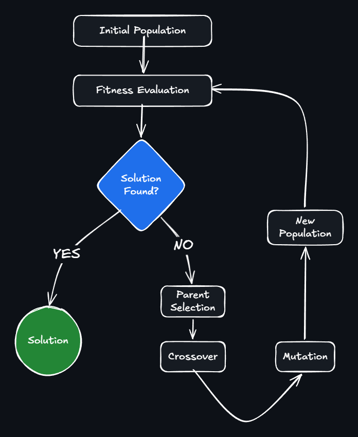
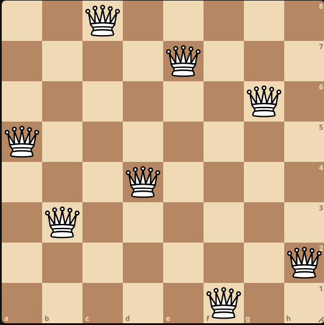
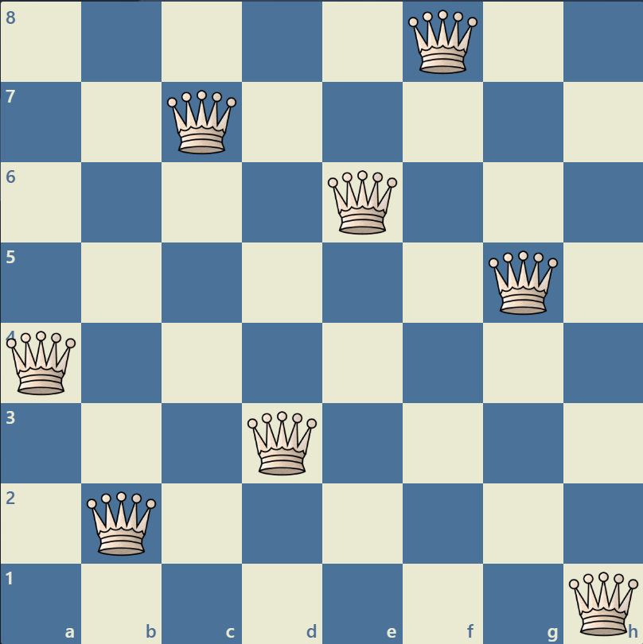
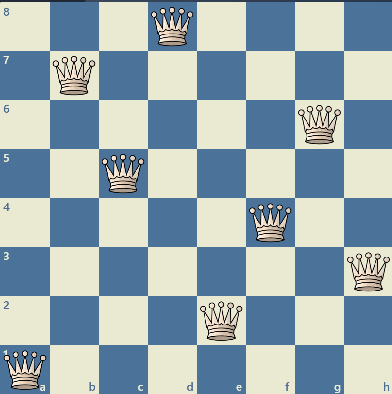
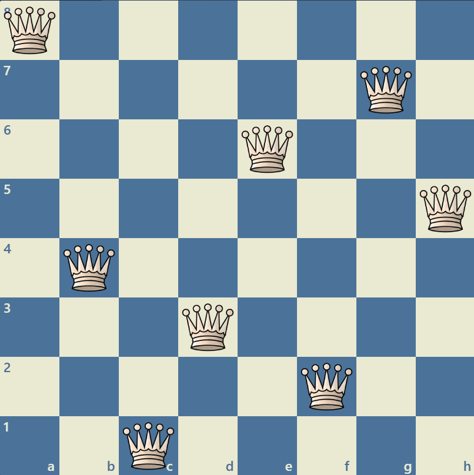
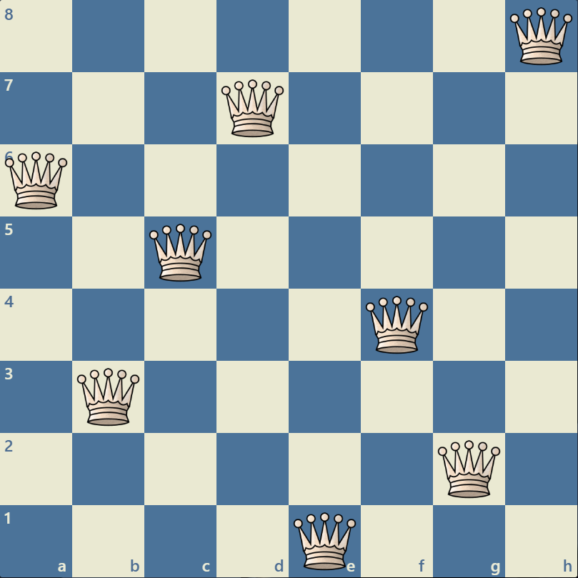
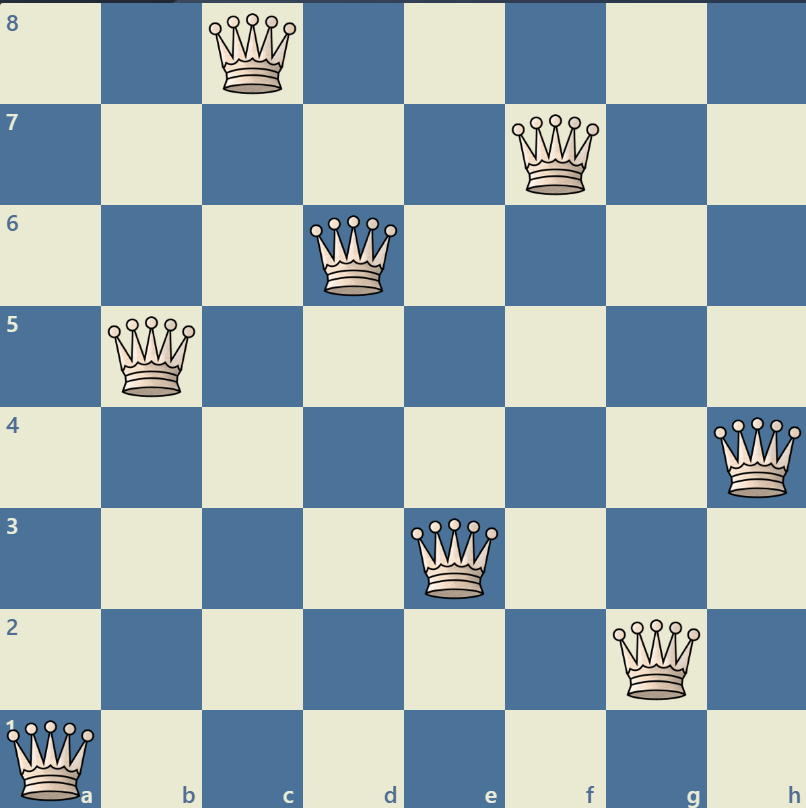
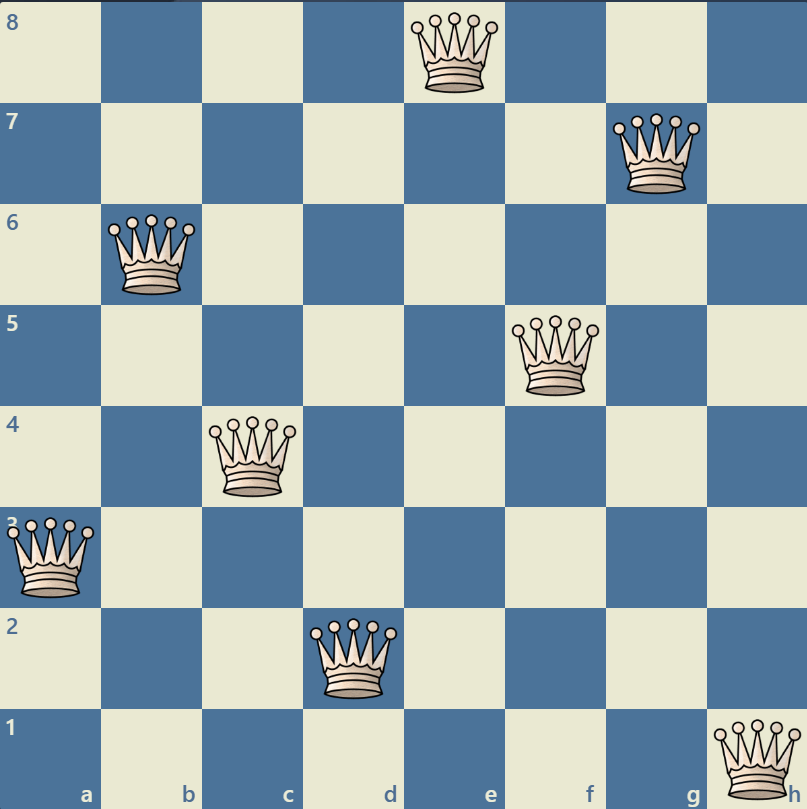
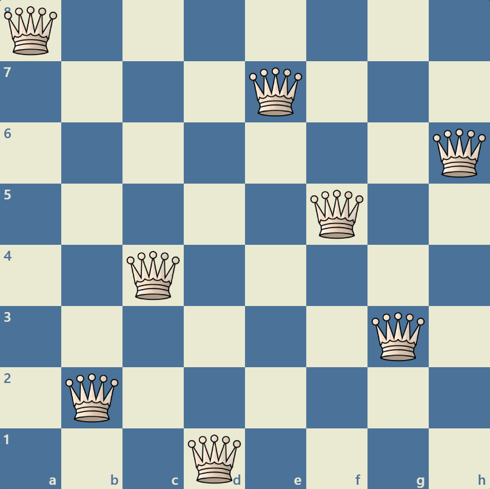

# ♛ N-Queens Problem — Solving with a Genetic Algorithm

> Project for the course Intelligent Systems and Decision Support Systems
> Implemented in Python using PyGAD & Streamlit

## Live Demo

Try the app live without any installation:

**[▶ Open in Streamlit](https://nqueens-ga.streamlit.app/)**

---

## Contents

1. [Problem Description](#1-problem-description)
2. [Genetic Algorithm — Theoretical Background](#2-genetic-algorithm--theoretical-background)
3. [Solution Representation](#3-solution-representation)
4. [Fitness Function](#4-fitness-function)
5. [Algorithm Operators](#5-algorithm-operators)
6. [Code Structure](#6-code-structure)
7. [User Interface (Streamlit)](#7-user-interface-streamlit)
8. [Installation & Execution](#8-installation--execution)
9. [Parameters & Impact on Performance](#9-parameters--impact-on-performance)
10. [Results & Observations](#10-results--observations)

---

## 1. Problem Description

The **N-Queens problem** asks for the placement of **N queens** on an NxN chessboard such that **no queen threatens any other**. Two queens conflict if they are on:

- The **same row** (horizontal conflict)
- The **same column** (vertical conflict)
- The **same diagonal** (diagonal conflict)

The problem becomes computationally hard for exhaustive search as N grows, 
since the search space grows at a rate of N!. For N=20, this corresponds to:
$20! \approx 2.4 \times 10^{18}$
possible arrangements, making the use of heuristic 
methods such as the Genetic Algorithm necessary.

---

## 2. Genetic Algorithm — Theoretical Background

A **Genetic Algorithm (GA)** is a metaheuristic technique inspired by biological evolution. It operates on a **population of candidate solutions** (chromosomes) and improves over successive generations.

### Evolution Cycle


### Core Principles

| Concept | Biological Analogue | In the Problem |
|---|---|---|
| Chromosome | DNA | Queen arrangement |
| Gene | DNA base | Row of each queen |
| Fitness | Survival | Inverse of conflicts |
| Crossover | Reproduction | Exchange of solution segments |
| Mutation | Random mutation | Random change of position |

---

## 3. Solution Representation

Each solution is represented as a **list of integers** of length N, where the **index** corresponds 
to the column and the **value** to the row of the queen. This representation compresses 
the chromosome from an N×N two-dimensional array ($N^{2}$ genes) into a one-dimensional 
list (N genes), dramatically reducing the search space.

```
Example for N=8:
index (col):  [0, 1, 2, 3, 4, 5, 6, 7]
value (row):  [2, 4, 6, 0, 3, 1, 7, 5]

Instead of 8×8 = 64 genes → only 8 genes
```


This representation **automatically eliminates vertical conflicts**, since each column has exactly one queen. The algorithm uses `allow_duplicate_genes=False` to prevent horizontal conflicts during initialization — the population starts as a set of **permutations** of `[0, N-1]`.

---

## 4. Fitness Function

```python
def fitness_func(ga_instance, solution, _):
    conflicts = 0
    for i in range(n):
        for j in range(i + 1, n):
            # Horizontal Conflict
            if solution[i] == solution[j]:
                conflicts += 1
            # Diagonal Conflict
            if abs(solution[i] - solution[j]) == abs(i - j):
                conflicts += 1
    return -conflicts
```

- **Time complexity:** $O(N^2)$ per chromosome
- **Value range:** `[-max_conflicts, 0]`
- **Optimal value:** `0` (no conflicts → solution found)
- **Termination:** The algorithm stops as soon as `fitness >= 0`

The negative definition (instead of a penalty) allows PyGAD to **maximize** the fitness, naturally steering the search toward zero conflicts.

---

## 5. Algorithm Operators

### 5.1 Parent Selection

| Type | Description |
|---|---|
| `tournament` | Random groups, the best one wins — balanced selection pressure |
| `rank` | Selection based on ranking, not absolute fitness |
| `rws` | Roulette Wheel — probability proportional to fitness |
| `random` | Random selection — as a baseline for comparison |
> Note: The Roulette Wheel technique does not work with a negative `fitness score`
### 5.2 Crossover

| Type | Description |
|---|---|
| `single_point` | A single random cut point |
| `two_points` | Two cut points |
| `uniform` | Each gene is chosen independently |
| `scattered` | Random bit mask |

### 5.3 Mutation

| Type | Description |
|---|---|
| `random` | Replaces a gene with a random value |
| `swap` | Swaps two random genes |
| `inversion` | Reverses a segment of the chromosome |
| `scramble` | Shuffles a segment of the chromosome |

### 5.4 Elitism

```python
keep_elitism = 0              # required for keep_parents to take effect (PyGAD ≥ 2.18)
keep_parents = pop_size // 2
```

50% of the population (the selected parents) is carried over to the next generation, reducing the risk of **losing good solutions**.

---

## 6. Code Structure

```
n-queens-ga/
│
├── app.py          # Streamlit UI — visualization & parameter controls
├── ga.py           # Genetic algorithm (PyGAD wrapper)
├── misc/               # Images used in the app and this README
├── requirements.txt
└── README.md
```

### `ga.py` — Core Functions

| Function | Description |
|---|---|
| `run_ga(...)` | Runs the genetic algorithm and returns the solution |
| `count_conflicts(board)` | Counts the conflicts of a solution |
| `board_to_2d(board)` | Converts the list into a 2D array |

### `app.py` — Key Components

| Component | Description |
|---|---|
| `render_chessboard(solution, n)` | Generates an HTML chessboard with inline SVG queens |
| `on_gen(gen, fitness, best_sol)` | Per-generation callback — updates the UI |
| `UI_THROTTLE = 0.25s` | Rate limiting for the Streamlit refresh |
| `shared{}` | Shared state between the callback and the main loop |

---

## 7. User Interface (Streamlit)

The app visualizes the evolution of the algorithm in **real time**:

- **Live metrics:** Generation, Best Fitness, Conflicts, Elapsed time
- **Live board:** The chessboard updates every 250ms with the best solution
- **Conflict highlighting:** Queens in conflict are shown in **red**
- **Adaptive board size:** `cell = min(60, 600 // n)` — N=8 → 60px/cell, N=20 → 30px/cell
- **Final state:** Green border if solved, red if not

---

## 8. Installation & Execution

### Requirements

```bash
python -m venv .venv
```

```bash
# Windows
.venv\Scripts\activate

# macOS/Linux
source .venv/bin/activate
```

```bash
pip install -r requirements.txt
```

### Run

```bash
streamlit run app.py
```

The app opens automatically at `http://localhost:8501`.

---

## 9. Parameters & Impact on Performance

| Parameter | Recommended Value | Effect |
|---|---|---|
| `pop_size` | 100–200 | Larger → slower per generation, better coverage of the search space |
| `mutation_probability` | 0.05–0.15 | Too low → stagnation, too high → random search |
| `parent_selection` | `tournament` | Best balance between exploration/exploitation |
| `crossover_type` | `single_point` | Simple and fast, but does not preserve permutations (see note below) |
| `mutation_type` | `swap` | Good starting choice — simple and effective |

> **Note:** The `swap`, `inversion` and `scramble` mutations preserve the permutation 
> property since they simply reorder existing values, preventing duplicates in the 
> chromosome. The `random` mutation has no such guarantee — PyGAD handles it 
> via `allow_duplicate_genes=False`, but this adds overhead to the algorithm.
>
> The same applies to the standard crossover operators (`single_point`, `two_points`, 
> `uniform`, `scattered`): combining segments of two permutations usually produces 
> duplicate genes, which then have to be repaired. Permutation-specific operators such 
> as PMX (Partially Mapped Crossover) or OX (Order Crossover) avoid this by design.

---

## 10. Results & Observations

- For **N ≤ 12**, the algorithm almost always finds a solution within a few seconds using the default parameters.
- For **N = 20**, a larger population (200+) and a higher mutation rate are required.
- The combination `tournament selection + swap mutation` showed **faster convergence** in testing.
- The problem admits **multiple optimal solutions** — for N=8 there are 92 distinct ones.

### Number of Solutions per N (OEIS A000170)
| Board size | Unique Solutions       | Total Solutions                 |
| ---------- | ---------------------- | ------------------------------- |
| 1          | 1                      | 1                               |
| 2          | 0                      | 0                               |
| 3          | 0                      | 0                               |
| 4          | 1                      | 2                               |
| 5          | 2                      | 10                              |
| 6          | 1                      | 4                               |
| 7          | 6                      | 40                              |
| 8          | 12                     | 92                              |
| 9          | 46                     | 352                             |
| 10         | 92                     | 724                             |
| 11         | 341                    | 2,680                           |
| 12         | 1,787                  | 14,200                          |
| 13         | 9,233                  | 73,712                          |
| 14         | 45,752                 | 365,596                         |
| 15         | 285,053                | 2,279,184                       |
| 16         | 1,846,955              | 14,772,512                      |
| 17         | 11,977,939             | 95,815,104                      |
| 18         | 83,263,591             | 666,090,624                     |
| 19         | 621,012,754            | 4,968,057,848                   |
| 20         | 4,878,666,808          | 39,029,188,884                  |
| 21         | 39,333,324,973         | 314,666,222,712                 |
| 22         | 336,376,244,042        | 2,691,008,701,644               |
| 23         | 3,029,242,658,210      | 24,233,937,684,440              |
| 24         | 28,439,272,956,934     | 227,514,171,973,736             |
| 25         | 275,986,683,743,434    | 2,207,893,435,808,352           |
| 26         | 2,789,712,466,510,289  | 22,317,699,616,364,044          |
| 27         | 29,363,495,934,315,694 | 234,907,967,154,122,528         |
---
**Total** solutions include every arrangement, including symmetric variants.
**Unique** (fundamental) solutions count each arrangement once —
each unique solution produces up to 8 variants through 3 rotations (90°, 180°, 270°)
and 4 reflections (horizontal, vertical, main diagonal, anti-diagonal).
For N=8: 92 total ÷ 8 variants ≈ 12 unique solutions. Notably,
N=6 has fewer solutions than N=5, showing that there is no
monotonic growth — and no known formula predicts the exact number
for general N.

Symmetry example for N=8 — the same unique solution and its 7 transformations:

<div align="center">
  <table style="table-layout: fixed; width: 100%;">
    <tr>
      <th width="180">Original</th>
      <th width="180">Rotation 90°</th>
      <th width="180">Rotation 180°</th>
      <th width="180">Rotation 270°</th>
    </tr>
    <tr>
      <td></td>
      <td></td>
      <td></td>
      <td></td>
    </tr>
    <tr>
      <th width="180">Horizontal reflection</th>
      <th width="180">Vertical reflection</th>
      <th width="180">Main diag. reflection</th>
      <th width="180">Anti-diag. reflection</th>
    </tr>
    <tr>
      <td></td>
      <td></td>
      <td></td>
      <td></td>
    </tr>
  </table>
</div>

## Future Work

- [ ] Zoom / fullscreen mode for the chessboard
- [ ] Performance comparison across different parameters
- [ ] Export solution to PNG
- [ ] Animated replay of the evolution per generation

## References

- Russell, S., & Norvig, P. (2020). *Artificial Intelligence: A Modern Approach* (4th ed.). Pearson.
- Goldberg, D. E. (1989). *Genetic Algorithms in Search, Optimization, and Machine Learning*. Addison-Wesley.
- PyGAD Documentation: https://pygad.readthedocs.io
- Sosič, R., & Gu, J. (1994). Efficient local search with conflict minimization: A case study of the n-queens problem. *IEEE TKDE*.
- *Number of ways of placing n nonattacking queens on an n X n board*: https://oeis.org/A000170
